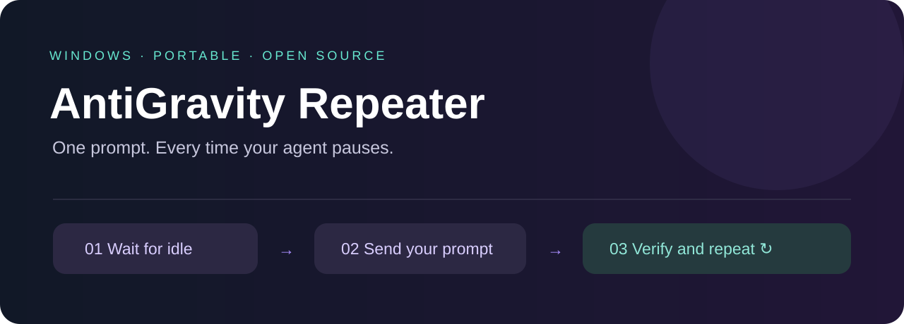
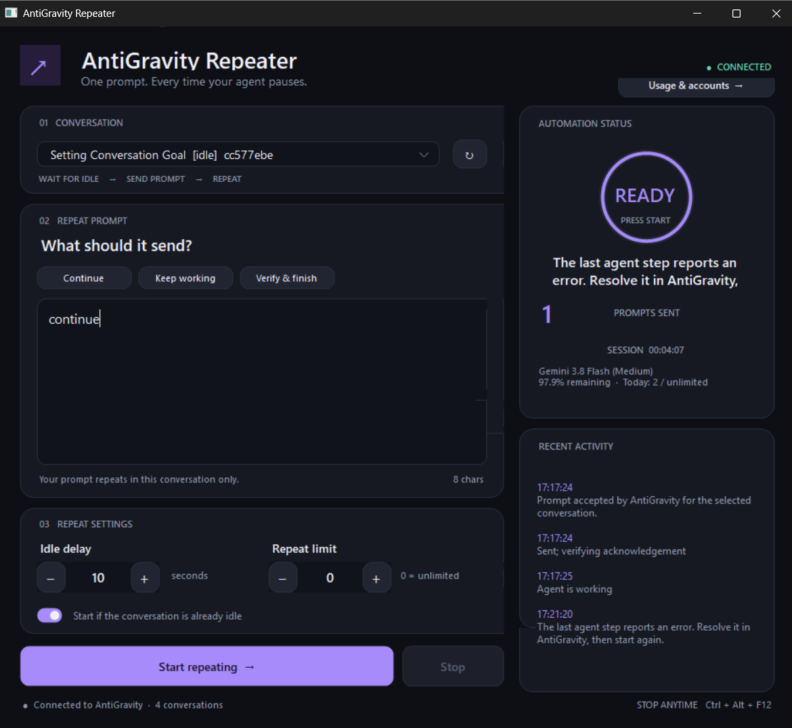
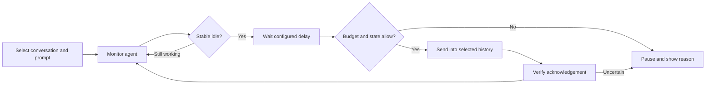
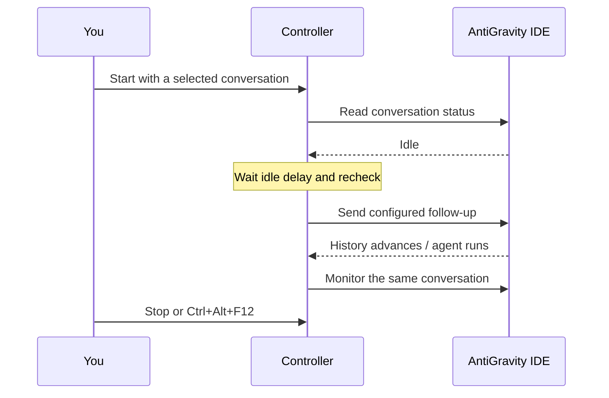

<div align="center">



# AntiGravity Repeater for Windows

**Automatically continue an AntiGravity IDE agent in the same conversation.**

[](docs/USER-GUIDE.md)
[](src/)
[](TEST-REPORT.md)
[](https://github.com/vikrant-project/antigravity-auto-continue/actions/workflows/build.yml)

[**Download Windows EXE**](https://github.com/vikrant-project/antigravity-auto-continue/releases/latest) · [User guide](docs/USER-GUIDE.md) · [Test evidence](TEST-REPORT.md) · [Report an issue](https://github.com/vikrant-project/antigravity-auto-continue/issues)

</div>

## Keep your agent moving

An agent finishes a turn before your larger task is done. You type `continue`, wait, and do it again. AntiGravity Repeater handles that repeated follow-up: choose one conversation, write your prompt, and set the delay. The controller waits for idle, sends the prompt, verifies acknowledgement, and monitors the next turn.

A native Windows dashboard puts the countdown, send count, activity, model allowance, and daily request budget in one place. No browser extension, mouse positioning, or keyboard macro is required.

> **Choose the right conversation.** Prompts go to the conversation selected in the controller, even when another chat is visible in the IDE. A “Desktop Controller Integration Test” chat is a test history, not your working chat. Stop repeating before changing targets.

## Start in a minute

1. Download **AntiGravityRepeater-Windows.zip** from [Releases](https://github.com/vikrant-project/antigravity-auto-continue/releases/latest) and extract it.
2. Keep AntiGravity IDE open and signed in. Run `AntiGravityRepeater.exe`.
3. Select your actual work conversation. Enter `continue` or your own follow-up.
4. Set an idle delay and repeat limit, then press **Start repeating**.
5. Press **Stop** or **Ctrl + Alt + F12** whenever you want to stop future prompts.

`0` repeat limit means unlimited. A daily budget of `0` means unlimited controller attempts. Stopping does not cancel an action already accepted by the IDE. Keep both apps running and the laptop awake.

The portable EXE uses Windows .NET Framework and needs no Node.js or Python installation. It is unsigned; managed Windows policies may require approved signing before allowing it to launch.

## The Windows dashboard



*Historical screenshot supplied during troubleshooting. It shows an older error state; the recovered-error handling was subsequently fixed. This image is an actual application capture, not a current successful-run claim.*

## What it does

| Capability | Behavior |
|---|---|
| Same-history continuation | Pins the selected conversation ID across repeated prompts |
| Idle-aware countdown | Waits for a stable idle state and checks again before sending |
| Acknowledgement tracking | Verifies history advancement and suppresses unchanged duplicate sends |
| Model continuity | Preserves the conversation's latest model and policy configuration |
| Usage display | Shows allowance, reset times and credits when reported by the IDE |
| Daily budget | Counts controller send attempts across accounts; resets at midnight IST |
| Saved accounts | Encrypts snapshots with Windows CurrentUser DPAPI |
| Account rotation | Can switch saved accounts on reported exhaustion; live two-account switching remains unverified |
| Quick control | Prompt presets, repeat cap, tray access and emergency stop |
| Recovery boundaries | Pauses for unresolved errors, approvals and uncertain delivery |

## How a repeat happens





## Compared with manual continuation

| Workflow | Manual `continue` | Generic timer macro | AntiGravity Repeater |
|---|:---:|:---:|:---:|
| Repeats without retyping | — | Yes | Yes |
| Waits for reported agent idle | You decide | Depends on macro | Yes |
| Targets a pinned conversation ID | You choose a chat | Usually focus-dependent | Yes |
| Tracks acknowledgement | You inspect | Depends on macro | Yes |
| Integrated daily request cap | You track | Depends on macro | Yes |
| Requires internal IDE interface compatibility | No | Depends on macro | Yes |

This is a workflow comparison, not a benchmark of third-party products. Repeating a prompt does not guarantee task completion or successful agent decisions.

## Tested, with evidence

| Verification | Recorded result |
|---|---|
| Offline regression suite | **85 assertions passed**, rerun before publication |
| Recorded live repeat test | **5 automatic repeats**, 6 user messages, 6 verified replies in one history |
| Final recorded live diagnostics | **90 assertions passed** in that run |
| Daily budget UI | Exactly one allowed attempt, then a budget stop |
| Stop and emergency hotkey | Recorded UI checks passed |
| Recovered intermediate error | Successful later completion now permits continuation |
| Two genuine Google accounts | **Not verified**; distinct account fixtures were tested |

Counts describe different runs and should not be added together. Live integration evidence was recorded on 21 October 2026 against the locally installed IDE package version 1.107.0. See [the detailed report](TEST-REPORT.md) and [sanitized JSON evidence](tests/).

The local IDE service is an internal interface. Updates may require changes. Network failures, expired sessions, approvals, device sleep and provider quotas still affect operation. This is an independent project, not an official Google product.

## Build from source

```powershell
.\build.ps1
.\dist\RepeaterDiagnostics.exe --self-test
```

Windows CI builds both executables and runs offline checks. For opt-in local integration diagnostics, see [the guide](docs/USER-GUIDE.md#build-and-test). Live tests consume ordinary model usage and create a separate test conversation.

| Source | Responsibility |
|---|---|
| `Core.cs` | Repeat state machine and settings |
| `Service.cs` | Local service discovery, status and send checks |
| `MainForm.cs`, `Design.cs` | Windows dashboard and controls |
| `Accounts.cs`, `AccountsUI.cs` | Usage, budgets and encrypted account profiles |
| `*Diagnostics.cs` | Regression, fixture and integration checks |

## Privacy and credentials

Runtime data stays under `%LOCALAPPDATA%\AntiGravityRepeater`. The prompt is saved in plain text in your local settings. Saved account snapshots use Windows DPAPI; they are not portable exports. The controller reads the IDE's local session information to operate. Do not publish AppData databases, login profiles, tokens, or vault files.

See [Security](SECURITY.md) and [account storage details](docs/USER-GUIDE.md#credential-storage). Use only accounts you own or are authorized to use, within the provider's rules.

## Contributing

Include your Windows version, IDE version, expected behavior and sanitized activity messages in a bug report. Never attach credentials. Improvements to compatibility, accessibility and test coverage are welcome. Source contributions can be proposed through pull requests; no independent license grant is currently specified.
